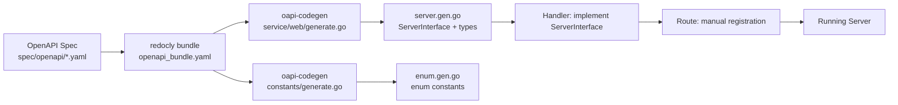

# OpenAPI Design-First Example API (Echo + oapi-codegen)

Reference implementation of a **Design-First** REST API using Go, Echo, and `oapi-codegen`. Demonstrates Clean Architecture with manual route registration, API Key authentication, PostgreSQL data access, and dual-track migrations.

---

## 📁 Project Structure

```
example/
├── main.go                      ← Entry point: config → DB connect → migrate → wire layers → start server
├── go.mod                       ← Go module definition
├── Makefile                     ← Build/run scripts
│
├── route/
│   └── web.go                   ← Manual route registration (public vs. protected groups)
│
├── middleware/
│   ├── apikey.go                ← API Key authentication middleware (header → query param fallback)
│   ├── middleware.go             ← Middleware interface + client implementation
│   ├── openapi.go               ← OpenAPI schema validation middleware
│   └── transform_response.go    ← Converts internal response types to JSON responses
│
├── service/
│   ├── web/                     ← Generated server code + handler implementation
│   │   ├── generate.go          ← //go:generate (oapi-codegen for Echo server)
│   │   ├── server.cfg.yaml      ← oapi-codegen config (echo-server + models + embedded-spec)
│   │   ├── server.gen.go        ← Generated: ServerInterface, parameter types, body types
│   │   ├── handlers.go          ← Implements ServerInterface → delegates to usecase layer
│   │   └── handlers_test.go     ← Handler unit tests (httptest + mock Usecase)
│   │
│   └── user/                    ← Domain service (user management)
│       ├── types.go             ← Repository & Usecase interfaces + ListParams
│       ├── usecase.go           ← Business logic: email-duplicate check, delete validation
│       ├── psql_repository.go   ← PostgreSQL implementation via sqlx (transactions, soft-delete)
│       ├── psql_repository_test.go      ← Repository integration tests
│       ├── psql_repository_suit_test.go ← Test suite setup
│       ├── usecase_test.go      ← Usecase unit tests (mock Repository)
│       └── mocks/               ← Auto-generated mocks via mockery (Repository, Usecase)
├── models/
│   ├── user.go                  ← User domain type (uses BlackMocca utils: Timestamp, EnumScan, JsonScan)
│   ├── permission.go            ← Permission entity + Permissions slice helper
│   └── paginator.go             ← Generic Paginator[T] with offset/limit and total calculation
│
├── constants/                   ← Generated enum types from OpenAPI spec
│   ├── generate.go              ← //go:generate (oapi-codegen for enums only)
│   ├── enum.cfg.yaml            ← oapi-codegen config (models only, skip-prune)
│   └── enum.gen.go              ← Enum types: Role, Status, Priority, ApplicationCode, etc.
│
├── migrations/
│   ├── migrate.go               ← Dual-track migration runner (schema + seed data)
│   └── database/postgres/       ← Migration SQL files
│       ├── schema_migrations/   ← 000001–000004: extensions, permissions, users, user_permissions (up/down)
│       │   ├── 000001_extension.up.sql / .down.sql
│       │   ├── 000002_create_permissions_table.up.sql / .down.sql
│       │   ├── 000003_create_users.up.sql / .down.sql
│       │   └── 000004_create_user_permissions.up.sql / .down.sql
│       └── master/              ← Seed data (up only, no down)
│           └── 000001_permission.up.sql
│
├── spec/openapi/                ← OpenAPI v3 specification (source of truth!)
│   ├── openapi.yaml             ← Entry point: paths $ref, components, securitySchemes
│   ├── enums.yaml               ← Enum definitions with x-enum-varnames
│   ├── global/components/       ← Shared schemas across all APIs
│   │   ├── parameters/          ← page, page_size, document_id
│   │   ├── schemas/             ← uuid.yaml, timestamp.yaml, paginator.yaml, response_success.yaml, response_error.yaml
│   │   └── securitySchemes/     ← apikey.yaml, jwt.yaml
│   ├── components/              ← Domain-specific (this API only)
│   │   ├── parameters/          ← role, search_word
│   │   └── schemas/             ← user.yaml, permission.yml
│   └── paths/                   ← One-file-per-operation pattern
│       ├── public/              ← health.yaml (GET /api/health)
│       └── users/               ← CRUD operations + request/response subdirectories
│
├── .env                         ← Local environment overrides
├── .env.example                 ← Environment variable reference
├── .mockery.yml                 ← Mockery configuration (auto-generates mocks)
├── Dockerfile                   ← Multi-stage build (golang → alpine)
└── docker-compose.yml           ← Dev environment (app + postgres)
```

---

## 🎯 Design-First Workflow



### Five Steps

1. **Write OpenAPI spec** — Define routes, schemas, enums, security schemes under `spec/openapi/`. The spec is the single source of truth.

2. **Bundle + Generate code**

   ```bash
   # Bundle multi-file spec into a single file (resolves all $ref)
   redocly bundle spec/openapi/openapi.yaml -o spec/openapi/openapi_bundle.yaml

   # Generate Go code — two targets:
   #   a) Echo server code + types (service/web/)
   #   b) Enum constants only (constants/)
   go generate ./...
   ```

3. **Implement handlers** — Build structs that implement `ServerInterface` with business logic, delegating to usecase and repository layers.

4. **Register routes manually** — Separate public (no auth) from protected (API Key) endpoints in `route/web.go`. Wrap the handler with `ServerInterfaceWrapper` for parameter binding.

5. **Transform responses** — All handlers return `middleware.Response` which is transformed by the `TransformResponse` middleware into JSON HTTP responses.

> 💡 The `generate.go` files in each package use **relative paths** to spec files:
> - `service/web/generate.go` → `../../spec/openapi/openapi_bundle.yaml` (2 levels up)
> - `constants/generate.go` → `../spec/openapi/enums.yaml` (1 level up)

---

## 🚀 Quick Start

```bash
# 1. Generate code from OpenAPI spec
redocly bundle spec/openapi/openapi.yaml -o spec/openapi/openapi_bundle.yaml
go generate ./...
go mod tidy

# 2. Set environment variables (see .env.example)
cp .env.example .env
# Edit .env: DATABASE_URL, APIKEY, etc.

# 3. Run server
go run .
# Server starts at http://localhost:3001
```

### Docker

```bash
docker compose up --build
```

---

## 🔒 Authentication (API Key)

API Key validation is applied at the **route level** — only protected routes require it.

| Method | Example | Description |
|--------|---------|-------------|
| **Header** (recommended) | `X-API-Key: exampleapikey` | Checked first, highest priority |
| **Query Parameter** | `?apikey=exampleapikey` | Fallback for mobile/web clients |

### Development Key

The default test key is `exampleapikey`. Set the `APIKEY` environment variable or `.env` value to change it.

---

## 📋 API Endpoints

### Public (no authentication)

| Endpoint | Method | Description |
|----------|--------|-------------|
| `/api/health` | GET | Health check (liveness probe) |

### Protected (API Key required) — Users CRUD

| Endpoint | Method | Description |
|----------|--------|-------------|
| `/api/v1/users` | GET | List users (pagination, search, role filter) |
| `/api/v1/users` | POST | Create a new user |
| `/api/v1/users/:id` | GET | Get user by ID |
| `/api/v1/users/:id` | PUT | Update user (partial update via JSON merge) |
| `/api/v1/users/:id` | DELETE | Soft-delete user (sets `deleted_at`) |

---

## 🧪 Testing with curl

### Health Check

```bash
curl http://localhost:3001/api/health
# {"code":"C20000","message":"successful","data":null}
```

### List Users

```bash
curl -H "X-API-Key: exampleapikey" \
     "http://localhost:3001/api/v1/users?page=1&page_size=10"
```

### Create User

```bash
curl -X POST http://localhost:3001/api/v1/users \
  -H "X-API-Key: exampleapikey" \
  -H "Content-Type: application/json" \
  -d '{
    "email": "john@example.com",
    "name": "John Doe",
    "role": "admin",
    "permission_ids": ["ee67cfb7-b7dc-4331-be82-e4c3fdc7ce2a"]
  }'
```

### Delete User (soft-delete)

```bash
curl -X DELETE http://localhost:3001/api/v1/users/{id} \
  -H "X-API-Key: exampleapikey"
# Returns the updated user with deleted_at set, status 200
```

---

## 🧪 Unit Testing

### Mock Generation

Mocks are auto-generated via [mockery](https://github.com/vektra/mockery) configured in `.mockery.yml`:

```bash
make gen-interface        # generates mocks into service/*/mocks/
```

Mocks are generated for interfaces defined in `service/user/types.go` (`Repository`, `Usecase`) into `service/user/mocks/`.

### Running Tests

```bash
make test-unit            # runs all *_test.go, generates cover.out + coverage.html
```

The Makefile automatically discovers test directories, excludes mocks/generated files, and reports coverage percentage.

### Handler Testing Pattern

Handlers return `error` but the value is always a `middleware.Response` struct. Test pattern:

```go
type middleware.Response struct {
    HttpStatus   int                 \`json:"-"\`
    ResponseCode constants.ApplicationCode  \`json:"code"\`
    ErrorType    constants.ApplicationErrorType \`json:"error_type,omitempty"\`
    Message      string              \`json:"message"\`
    Data         interface{}         \`json:"data"\`
}
```

Extract and assert every field:
```go
func extractResponse(t *testing.T, handlerErr error) middleware.Response {
    resp, ok := handlerErr.(middleware.Response)
    require.True(t, ok, "expected middleware.Response but got %T", handlerErr)
    return resp
}

resp := extractResponse(t, handlerErr)
assert.Equal(t, http.StatusOK, resp.HttpStatus)
assert.Equal(t, constants.ApplicationCodeSuccess, resp.ResponseCode)
```

Use `.Run(func(ctx, params) { ... })` to inspect arguments passed to mocks.

### Usecase Testing Pattern

Usecases depend on Repository interface — mock it with testify:
```go
mockRepo := mocks.NewMockRepository(t)
uc := user.NewUserUsecase(mockRepo)

mockRepo.EXPECT().FindByID(mock.Anything, id.String()).
    Run(func(ctx context.Context, idStr string) {
        assert.Equal(t, "expected-id", idStr)
    }).Return(user, nil)
```

For multi-step operations (e.g., Delete: FindByID → check → Delete), define expectations in call order and verify counts:
```go
mockRepo.AssertNumberOfCalls(t, "FindByID", 1)
mockRepo.AssertNumberOfCalls(t, "Save", 0)  // not called because error occurred earlier
```

---

## 🗄️ Migrations (Dual-Track Pattern)

This project uses **two independent migration tracks** with separate tracking tables:

| Track | Directory | Tracking Table | Direction | Purpose |
|-------|-----------|----------------|-----------|---------|
| Schema migrations | `database/postgres/schema_migrations/` | `schema_migrations` (per-schema) | Up + Down | CREATE/DROP/ALTER tables and columns |
| Seed data (master) | `database/postgres/master/` | `seed_migrations` (per-schema) | Up only | INSERT reference data, defaults, lookups |

**Why dual track?**
- Schema migrations must run **before** seed data (you can't INSERT into a table that doesn't exist yet)
- Seed data uses `ON CONFLICT DO NOTHING` — idempotent and safe to rerun
- Schema migrations are fully reversible (.down.sql for each .up.sql)
- Seed data is NOT reversed (no .down.sql files in master/)

**Migration file naming:**
| Pattern | Example | Description |
|---------|---------|-------------|
| `000001_extension.up.sql` / `.down.sql` | ✅ | Schema migration — numbered, reversible |
| `000001_permission.up.sql` (no .down.sql) | ✅ | Seed data — up only in master/ directory |

**Rules:**
- [ ] Schema migrations are reversible with corresponding .down.sql files
- [ ] Seed data uses `ON CONFLICT DO NOTHING` for idempotent reruns
- [ ] Migrations ordered by dependency (extensions → tables → indexes)
- [ ] Each track uses its own migrations table: `schema_migrations` vs `seed_migrations`

---

## 🔑 Enums (Generated from OpenAPI `x-enum-varnames`)

Enums are type-safe Go constants with a `.Valid()` method. Invalid values cause compile errors:

```go
var role constants.Role = constants.RoleAdmin   // ✅ valid
// var bad constants.Role = "superadmin"        // ❌ compile error!

if role.Valid() { ... }                          // ✅ runtime check
fmt.Println(role)                                // → "admin"
```

| Enum | Values | Go Constants |
|------|--------|--------------|
| `Role` | admin, user, moderator | `RoleAdmin`, `RoleUser`, `RoleModerator` |
| `Status` | active, inactive, pending | `StatusActive`, `StatusInactive`, `StatusPending` |
| `Priority` | low, medium, high, critical | `PriorityLow`, `PriorityMedium`, `PriorityHigh`, `PriorityCritical` |

---

## 📊 Application Error Format

All responses follow a consistent envelope:

```json
{
  "code": "C20000",
  "error_type": "invalid_arguments",
  "message": "description",
  "data": null
}
```

| Code | Error Type | HTTP Status |
|------|------------|-------------|
| `C20000` | *(none)* | 200 OK |
| `C40000` | `invalid_arguments` | 400 Bad Request |
| `C40100` | `apikey_invalid` | 401 Unauthorized |
| `C40901` | `conflict` | 409 Conflict (duplicate email) |
| `C40902` | `conflict` | 409 Conflict (already removed) |
| `C50000` | `internal_server_error` | 500 Internal Server Error |

---

## 🏗️ Architecture Overview

```
HTTP Request
    │
    ▼
┌─────────────────────────┐
│  Middleware Layer        │  API Key auth → TransformResponse → OpenAPI validation
│  (route/web.go)          │  Public routes skip auth; protected routes inject it
└───────────┬─────────────┘
            │
            ▼
┌─────────────────────────┐
│  Handler Layer           │  service/web/handlers.go
│  (implements             │  Uses oapi-codegen wrapper for parameter binding
│   ServerInterface)        │  Delegates to user.Usecase via fn.CopyJSON
└───────────┬─────────────┘
            │
            ▼
┌─────────────────────────┐
│  Usecase Layer           │  service/user/usecase.go
│                          │  Business rules: duplicate check, delete validation
└───────────┬─────────────┘
            │
            ▼
┌─────────────────────────┐
│  Repository Layer        │  service/user/psql_repository.go
│  (implements             │  Transactions per request; soft-delete; LEFT JOIN pagination
│   Repository interface)   │
└───────────┬─────────────┘
            │
            ▼
┌─────────────────────────┐
│  Data Access             │  BlackMocca utils/connectors/psql (sqlx pool, pgx driver)
└─────────────────────────┘
```

**Dependency direction**: infrastructure → data access → usecase → web → routes. All flow inward toward abstractions.

---

## 🔧 Regenerate Code After Spec Changes

```bash
# 1. Edit spec files (one-file-per-operation pattern)
# 2. Bundle and regenerate
redocly bundle spec/openapi/openapi.yaml -o spec/openapi/openapi_bundle.yaml
go generate ./...

# 3. Rebuild and test
go build -o example . && ./example
```

---

## 🧠 Why Manual Route Registration?

| Feature | Auto (`RegisterHandlersWithBaseURL`) | Manual (this project) ✅ |
|---------|--------------------------------------|--------------------------|
| Middleware placement | Hard to separate public/protected | Clear separation at route level |
| Public routes | Requires post-hoc override | Registered first, no middleware |
| Parameter binding | ✅ From wrapper | ✅ Same wrapper works |
| Flexibility | 100% tied to spec | Add custom logic freely |

```go
// Protected routes — API Key enforced at route level
r.e.GET("/api/v1/users", w.ListUsers, r.middl.APIKeyAuth)
r.e.POST("/api/v1/users", w.CreateUser, r.middl.APIKeyAuth)
```

---

## 🛠️ Key Dependencies

| Package | Purpose |
|---------|---------|
| `github.com/labstack/echo/v4` | HTTP framework |
| `github.com/oapi-codegen/runtime` | OpenAPI spec compliance types |
| `github.com/BlackMocca/utils/connectors/psql` | Pooled PostgreSQL client (pgx + sqlx) |
| `github.com/BlackMocca/utils/fn` | Struct conversion: `ConvertStruct`, `CopyJSON` |
| `github.com/BlackMocca/utils/models` | Typed DB types: `Timestamp`, `EnumScan`, `JsonScan` |
| `github.com/golang-migrate/migrate/v4` | Database migrations (dual-track) |
| `github.com/google/uuid` | UUID generation and parsing |
| `github.com/guregu/null/v6` | Nullable types (`zero.String`) for DB columns |

---

## 📚 Reference Files

| File | Role |
|------|------|
| `spec/openapi/openapi.yaml` | Spec entry point (source of truth) |
| `constants/enum.gen.go` | Generated enum constants + `.Valid()` |
| `service/web/server.gen.go` | Generated server interface + types |
| `route/web.go` | Public vs. protected route registration |
| `middleware/apikey.go` | API Key auth (header → query param) |
| `service/user/types.go` | Repository & Usecase interfaces |
| `service/user/usecase.go` | Business logic layer |
| `migrations/migrate.go` | Dual-track migration runner |

---

## Best Practices Applied

1. **Spec is the single source of truth** — all types and endpoints flow from OpenAPI YAML
2. **One-file-per-operation** — minimal merge conflicts, easy to find/edit individual endpoints
3. **Interface-based dependency injection** — every layer depends on abstractions, not concrete implementations
4. **Type-safe enums** — compile-time constant enforcement prevents invalid values
5. **Application-level error codes** (`C20000`, `C40901`) — structured errors beyond HTTP status alone
6. **Relative paths in generate directives** — portable across machines and repo clones
7. **Dual-track migrations** — schema changes (reversible) separated from seed data (one-way with conflict-safe inserts)
